

<picture><source media="(prefers-color-scheme: dark)" srcset="assets/header-dark.svg"></picture>

 

I build web apps and tools that people use in their daily work. I studied physics, so I break problems down, test every assumption, and **keep going until they work.**

 

<picture><source media="(prefers-color-scheme: dark)" srcset="assets/stack-dark.svg"></picture>

  

<picture><source media="(prefers-color-scheme: dark)" srcset="assets/title-work-dark.svg">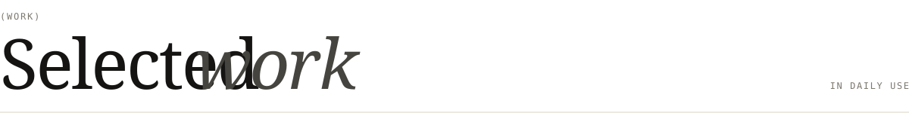</picture>

  <picture><source media="(prefers-color-scheme: dark)" srcset="assets/card-audit-dark.svg">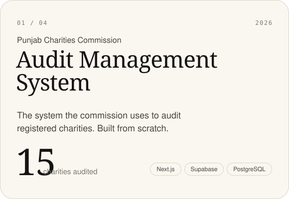</picture>
  <picture><source media="(prefers-color-scheme: dark)" srcset="assets/card-chat-dark.svg">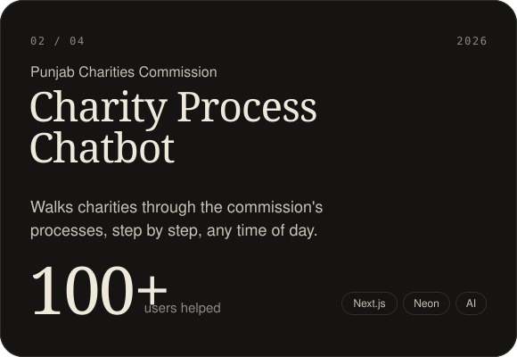</picture>

  <a href="https://wordpress.org/plugins/modulustools-seo-suite/"><picture><source media="(prefers-color-scheme: dark)" srcset="assets/card-seo-dark.svg">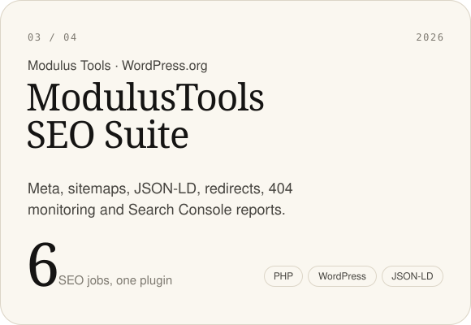</picture></a>
  <picture><source media="(prefers-color-scheme: dark)" srcset="assets/card-paper-dark.svg">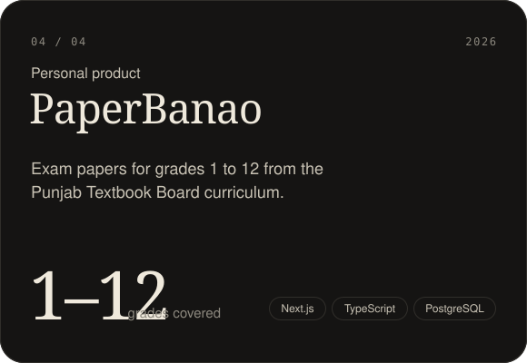</picture>

The first two are in daily use at the **Punjab Charities Commission** (Home Department, Government of the Punjab), where I joined in January 2026. I designed and built both and keep improving them.

 

<picture><source media="(prefers-color-scheme: dark)" srcset="assets/title-studio-dark.svg">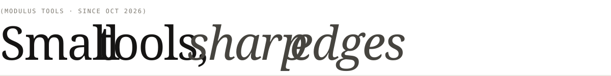</picture>

**[Modulus Tools](https://modulustools.com)** is my small software studio. It publishes browser extensions on the Chrome Web Store. Click a card to install.

  <a href="https://chromewebstore.google.com/detail/imagus/bdlicplmkecjmlefjndmgfgcdnilocio"><picture><source media="(prefers-color-scheme: dark)" srcset="assets/ext-imagus-dark.svg"></picture></a>
  <a href="https://chromewebstore.google.com/detail/autoplaystopper/njbikmhihfdomkfimalmkfcnmjcooihp"><picture><source media="(prefers-color-scheme: dark)" srcset="assets/ext-autoplay-dark.svg">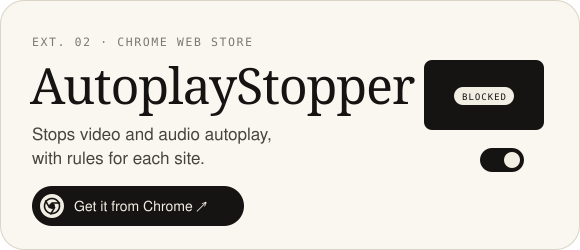</picture></a>

  <a href="https://chromewebstore.google.com/detail/linkclump/leophljmgneicoeeclgggbojeajbdbio"><picture><source media="(prefers-color-scheme: dark)" srcset="assets/ext-linkclump-dark.svg">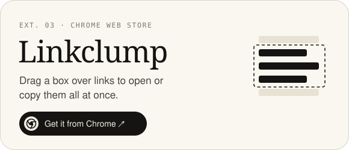</picture></a>
  <a href="https://chromewebstore.google.com/detail/downalbum/lokcefdcipipcemdpcndendbdjbmacpk"><picture><source media="(prefers-color-scheme: dark)" srcset="assets/ext-downalbum-dark.svg"></picture></a>

Need an extension built for your team? &nbsp;→&nbsp; **[Build one with Modulus Tools](https://modulustools.com/build-an-extension)**

 

<picture><source media="(prefers-color-scheme: dark)" srcset="assets/title-path-dark.svg"></picture>

| When | What |
| :-- | :-- |
| `2023` | **BS Physics**, COMSATS University Lahore. CGPA 3.26. Final year project: strontium ferrite nanoparticles by sol-gel auto-combustion. |
| `2023` | **Certificate in IT**, KICS, UET Lahore. JavaScript was the part that pulled me in. |
| `2024–25` | **Self-taught**: JavaScript → React → Next.js. Built projects, threw them away, built better ones. |
| `2025` | **AI joins the workflow.** It helps me learn and ship faster. I still read, test and fix the code. |
| `Jan 2026` | **Computer Operator**, Punjab Charities Commission. Built two systems now in daily use. |
| `Oct 2026` | **Founded [Modulus Tools](https://modulustools.com).** Extensions, a WordPress plugin, and custom work for clients. |

 

<picture><source media="(prefers-color-scheme: dark)" srcset="assets/contact-dark.svg"></picture>

  <a href="mailto:usamanazir13@gmail.com"><b>usamanazir13@gmail.com</b></a>
  &nbsp;·&nbsp;
  <a href="https://linkedin.com/in/usamanazir13">LinkedIn</a>
  &nbsp;·&nbsp;
  <a href="https://modulustools.com">modulustools.com</a>
  &nbsp;·&nbsp;
  +92 312 4156411

Open to remote roles and freelance projects. Also applying for scholarships to study abroad.

